# RememberStack

[](https://github.com/writeitai/remember-stack/actions/workflows/ci.yml)
[](https://remember.dev/docs)
[](https://pypi.org/project/remember/)
[](LICENSE)

**Memory engine for AI agents**

Process anything relevant: email, chat, specs, meeting notes, tickets, images,
video, audio.

The information is organized and stored.

Your agents have easy access to the information - they remember!

**[Read the docs](https://remember.dev/docs)** ·
**[Quickstart](https://remember.dev/docs/start/quickstart)** ·
**[What is a memory system?](https://remember.dev/docs/start/what-is-a-memory-system)**

**89.94% accuracy on LoCoMo benchmark.**

<br />

<p align="center">
  
</p>

---

## Main features

- **What each source said.** Every statement worth keeping is stored as a
  claim, with the exact passage it came from and the date it was said.
  Claims are never edited.
- **Who and what it is about.** Names become entities. "John", "John S."
  and "our backend lead" can resolve to one person, while two people called
  Dana stay two. Each entity keeps every spelling the sources used and a
  short profile, and a merge can be undone.
- **What is true now.** From those claims it maintains facts about the
  people, systems and decisions in your work. When a newer source changes a
  fact, the fact changes and the old one stays on record. When two sources
  disagree, you see both, marked as a contradiction.
- **When it was true.** Facts carry the period in which they held. Ask what
  is true today, what held last March, or how something changed.
- **Where it came from.** Every fact links to its claims, every claim to the
  characters in the source. Your agent can quote and cite; you can check.

<p align="center">
  
</p>

## Built for agents

- **MCP.** `remember mcp` gives Claude Code, Cursor, Codex, Claude Desktop and
  other MCP clients the memory tools; `remember setup` configures them in one
  command. [Connect your agent →](https://remember.dev/docs/start/connect-your-agent)
- **Python SDK and CLI.** `pip install remember`.
  [SDK →](https://remember.dev/docs/reference/python-sdk) ·
  [CLI →](https://remember.dev/docs/reference/cli)
- **HTTP API.** The same operations over plain HTTP.
  [API →](https://remember.dev/docs/reference/http-api)
- **Your files.** Markdown, text, HTML, Word, PowerPoint and Excel convert out
  of the box; PDFs and images with an OCR converter.
  [File types →](https://remember.dev/docs/guides/file-types)

## Quickstart

You need Docker (Engine 28 or later for the tokenless local setup) and an
[OpenRouter](https://openrouter.ai) API key.

```bash
git clone https://github.com/writeitai/remember-stack && cd remember-stack
cp .env.example .env
printf 'REMEMBERSTACK_POSTGRES_PASSWORD=%s\nREMEMBERSTACK_MINIO_ACCESS_KEY=%s\nREMEMBERSTACK_MINIO_SECRET_KEY=%s\nREMEMBERSTACK_SELFHOST_DEPLOYMENT_ID=%s\n' \
  "$(openssl rand -hex 32)" "$(openssl rand -hex 12)" "$(openssl rand -hex 32)" \
  "$(openssl rand -hex 16 | sed -E 's/^(.{8})(.{4}).(.{3}).(.{3})(.{12})$/\1-\2-4\3-8\4-\5/')" >> .env
# edit .env: set REMEMBERSTACK_OPENROUTER_API_KEY
docker compose up -d --build

uvx remember setup --self-hosted   # connect your coding agent
```

Then send a document and ask your first question:
**[Quickstart →](https://remember.dev/docs/start/quickstart)** ·
**[Self-hosting →](https://remember.dev/docs/self-hosting/install)**

## Open source, all of it

Apache-2.0. Everything that decides what your memory holds (extraction,
entity resolution, supersession, provenance, forgetting) is in this
repository. Nothing that affects correctness is held back.

- Docs: [remember.dev/docs](https://remember.dev/docs)
- Current release: [v0.19.1](https://github.com/writeitai/remember-stack/releases/tag/v0.19.1) ·
  [PyPI](https://pypi.org/project/remember/) ·
  [container](https://github.com/writeitai/remember-stack/pkgs/container/remember-stack)
- How it works inside: [architecture](https://remember.dev/docs/concepts/architecture) ·
  [design corpus](plan/README.md) · [decision log](decisions.md)

## Contributing

See [CONTRIBUTING.md](CONTRIBUTING.md) and [CLA.md](CLA.md). Pull requests need
the contributor-agreement checkbox in the PR template.
